# Devset CLI - Automating Development Environment Setup
 
`devset` is a CLI tool designed to streamline VTEX development environments. It eliminates repetitive manual setup by automating:

- **Repository Cloning:** Select and clone a repository from the available projects;
- **Git branch creation:** Create branches using Jira task IDs and predefined branch types;
- **VTEX workspace setup:** Create workspace using Jira task IDs;
- **Environment Setup:** Easily configure your entire development environment by selecting your preferred options:
  - Create Git branch and VTEX workspace;
  - Clone repository, create Git branch and VTEX workspace;
- **Favorite task management**: A great option for developers who work on multiple tasks at the same time. The favorites list makes it easier to return to the correct environment settings and keep working.

The goal is to get developers up and running with their VTEX projects in seconds. 


## ⚙️ Installation
#### ⚠️ 1. Requirements
<details>
<summary><i>Click to expand</i></summary>
Before installing `devset`, make sure you have the following tools installed:

- [Node.js](https://nodejs.org/) (v20 or higher)
- npm
- Git
- VTEX CLI
- Access to the VTEX accounts and repositories you intend to use

</details>
 
####  🔒 2. Token Configuration

You can set up tokens to access and clone repositories from GitHub and Bitbucket. If both are configured, a selection prompt will appear so you can choose which one to use when cloning.
 
<details> 
<summary><i>Bitbucket (Click to expand)</i></summary>
<br>

#### 2.1. Generate token
- Go to: **Bitbucket → Account settings → Security → Create and manage API tokens → Create API token with scopes**) 

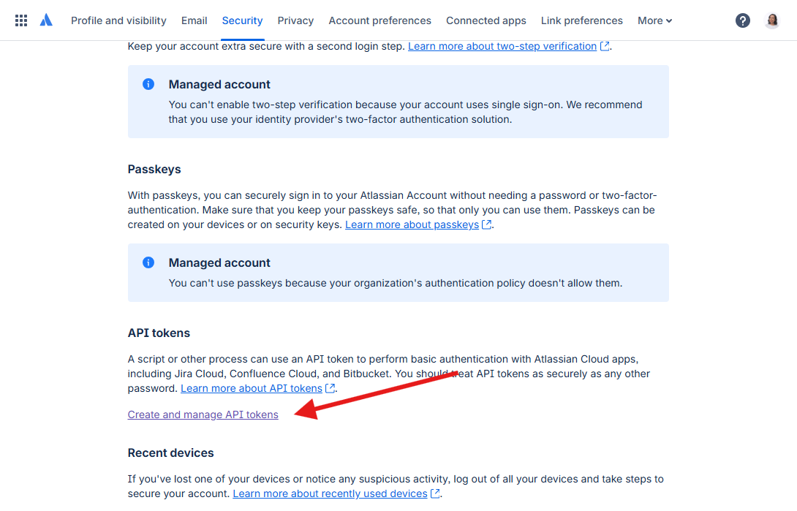

- Use the following configuration:

| Setting     | Value                |
| ----------- | -------------------- |
| Label       | `devset-cli`         |
| Permissions | `Repositories: Read` |

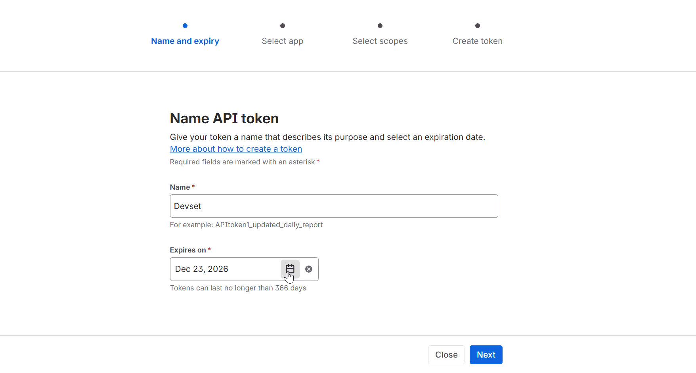 

#### 2.2. Create the environment variables
DevSetup uses dedicated environment variables for Bitbucket authentication and project filtering:
- `DEVSETUP_BITBUCKET_TOKEN`
- `DEVSETUP_BITBUCKET_PROJECTS`

You can find the correct project key in the URL:

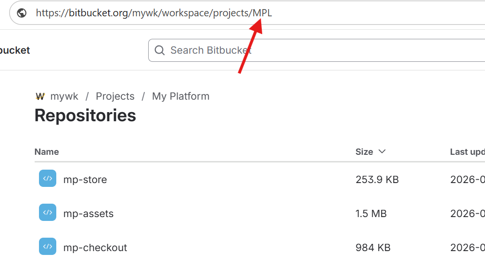 

##### Windows
- Press the Windows key and search for **Edit environment variables for your account**

Under **User variables**, create the following variables:

1. **Token variable:**
   - Variable name: **DEVSETUP_BITBUCKET_TOKEN**
   - Variable value: **your Bitbucket token**

2. **Projects variable:**

   - Variable name: **DEVSETUP_BITBUCKET_PROJECTS**
   - Variable value: **your project key(s)** (e.g., `LBP` for a single project, or `LBP,CBP` for multiple projects separated by commas)


##### WSL
You can set the variables directly in your user shell profile without needing administrator (`sudo`) privileges.

- Open your WSL terminal and add the variables to your shell configuration file (`~/.bashrc` or `~/.zshrc`):
```bash
echo 'export DEVSETUP_BITBUCKET_TOKEN="your_bitbucket_token"' >> ~/.bashrc
echo 'export DEVSETUP_BITBUCKET_PROJECTS="LBP,CBP"' >> ~/.bashrc
```

- Reload your shell configuration:
```bash
source ~/.bashrc
```

</details>

<details> 
<summary><i>GitHub (Click to expand)</i></summary>


#### 2.1. Generate token
- Go to: **GitHub → Settings → Developer settings → Personal access tokens → Tokens (classic)**
- Select: **Generate new token (classic)**
- Use the following configuration:

| Setting    | Value                 |
| ---------- | --------------------- |
| Note       | devset-cli            |
| Expiration | 90 days (recommended) |
| Scopes     | `repo`                |

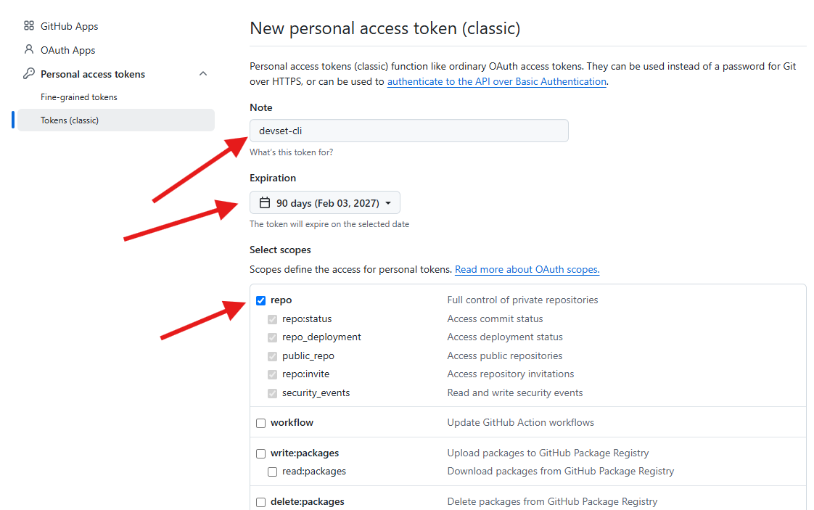

- Click the button **Generate token**.
- GitHub will display the token only once. Copy the token and store it securely.

#### 2.2. Configure SSO   
- In GitHub, go to: **Settings → Developer settings → Personal access tokens → Tokens (classic)**
- Find the `devset-cli` token and select: **Configure SSO**
- Authorize the token for the organization.

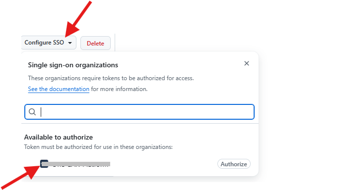

#### 2.3. Create the environment variable
DevSetup uses a dedicated environment variable:
``
DEVSETUP_GITHUB_TOKEN
``

##### Windows
- Press the Windows key and search for **Edit environment variables for your account**

Under **User variables**, create a new variable:
- Variable name: **DEVSETUP_GITHUB_TOKEN**
- Variable value: **your GitHub token**

Using a user environment variable is recommended because the token is only required by the local development environment.


##### WSL
You can set the variable directly in your user shell profile without needing administrator (`sudo`) privileges.

- Open your WSL terminal and add the variable to your shell configuration file (`~/.bashrc` or `~/.zshrc`):
```
echo 'export DEVSETUP_GITHUB_TOKEN="your_github_token"' >> ~/.bashrc
```

- Reload your shell configuration:
```
source ~/.bashrc
```

</details>

#### ⚙️ 3. Install
After cloning this repository, open it in your terminal and run the following commands: 
```bash
npm install
npm run build
npm link
```
 
After linking, you can use `devset` from any terminal. 

## ✨ Ready to start! Commands to make your routine easier:


###  Command to clone a repository:
 
```bash
devset clone
```

If you configured tokens for Bitbucket and Github, a selection prompt will appear so you can choose which one:

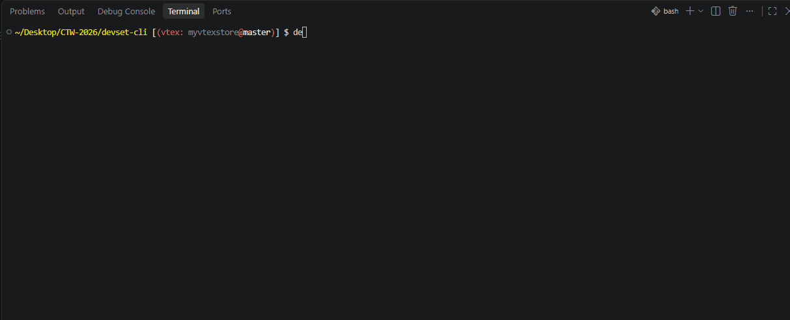

If only one token was configured:

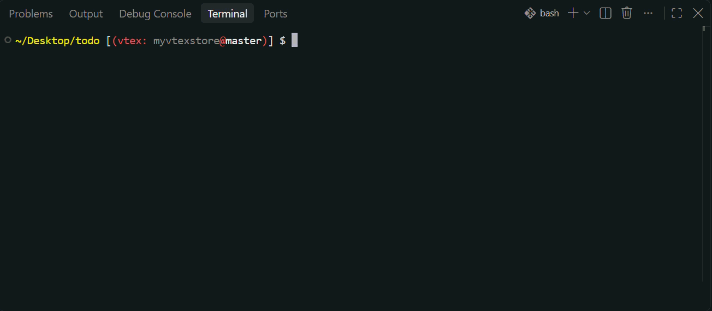

### Command to create a Git branch

Create a standardized Git branch using a Jira task ID. When running this command, the CLI will interactively prompt you to:
- Select the **branch type** (`feature`, `bugfix`, `hotfix`, `other`);
- Choose whether to create it from the **default branch** (e.g., `main` ) or enter the name of a **custom base branch**;
- If the repository is **one-lar-platform**: Choose whether to automatically `bugfix/OLP-001-to-homolog` based on the homolog branch for example.

```bash
devset branch OLP-001
``` 
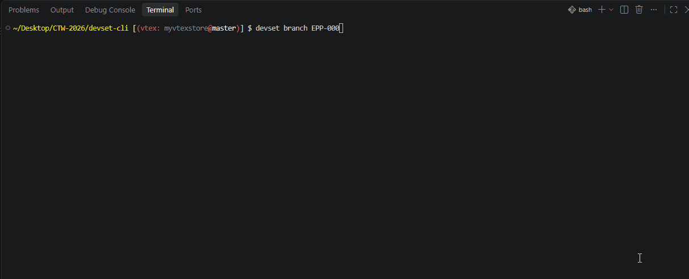
 
### Set up a complete development environment  
Automate the environment setup process with two interactive workflows:
* **Create Git branch and VTEX workspace:** Sets up the branch and workspace directly (requires running the command inside an existing repository directory).
* **Clone repository, create Git branch and VTEX workspace:** Clones the target repository, navigates into its directory, and configures both the Git branch and VTEX workspace automatically. 

```bash
devset setup OLP-001
```
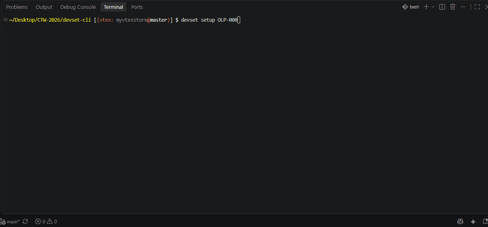


### Manage favorites


Save a task to your favorites with a nickname so you can easily switch to the right branch, workspace, and account without having to remember the task ID.


#### List favorites

Display all saved favorite tasks.

```bash
devset fav list
```
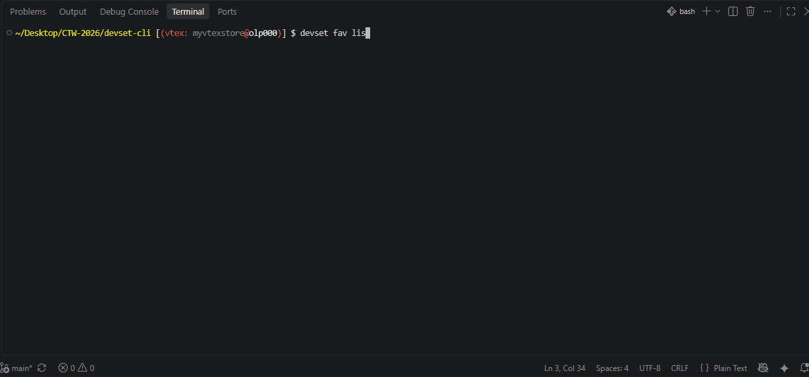

#### Add a favorite

The command interactively collects the information required to save a favorite, including its nickname, Jira task ID, VTEX account, and branch name.

```bash
devset fav add
```
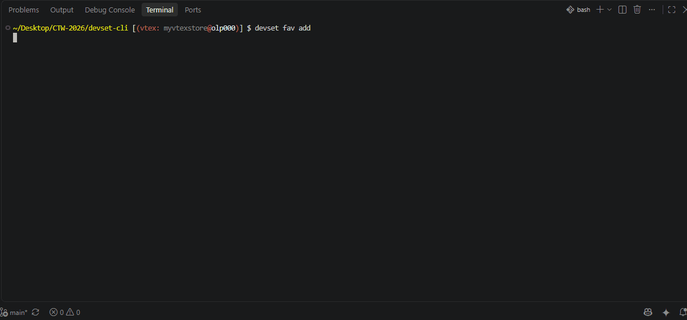

 
#### Remove a favorite

Remove a saved favorite task.
```bash
devset fav remove
```
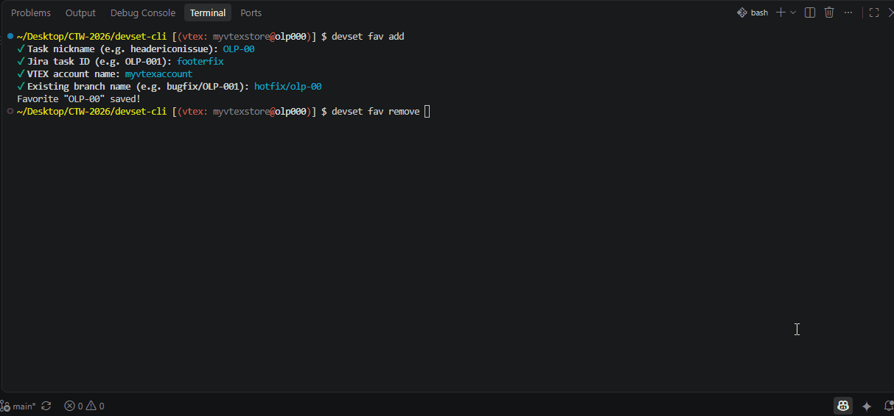

#### Start or return to your favorite task

Start or switch back to a development environment using a **saved favorite**. This command automatically:

- Logs in to the configured VTEX account.
- Checks out the saved Git branch.
- Selects the corresponding VTEX workspace.

With your terminal open inside the task's repository folder and run:

```bash
devset start <nickname>
```
*You can remember the nickname running: devset fav list*


  
___
## ❔Help 
To display the available commands and their descriptions: 
```bash
devset --help
``` 
To display the help for a specific command:
```bash 
devset fav --help
devset start --help
```
___
## 💡Support & Feedback

#### Do you need help or do you have any ideas to improve this CLI?

Please fill out the form:
[Devset CLI Support and Feedback Form](https://docs.google.com/forms/d/e/1FAIpQLSdyxuQq10NaswxdrH9ZdS5apSbUX8hTuDhTu74djsEYSlM_cw/viewform?usp=publish-editor)


#### Did you make any changes to this CLI? 

If you make changes to the source code, rebuild the project before testing. 

```bash
npm run build
``` 
If the CLI is already linked using `npm link`, the updated build can be executed through the `devset` command. 